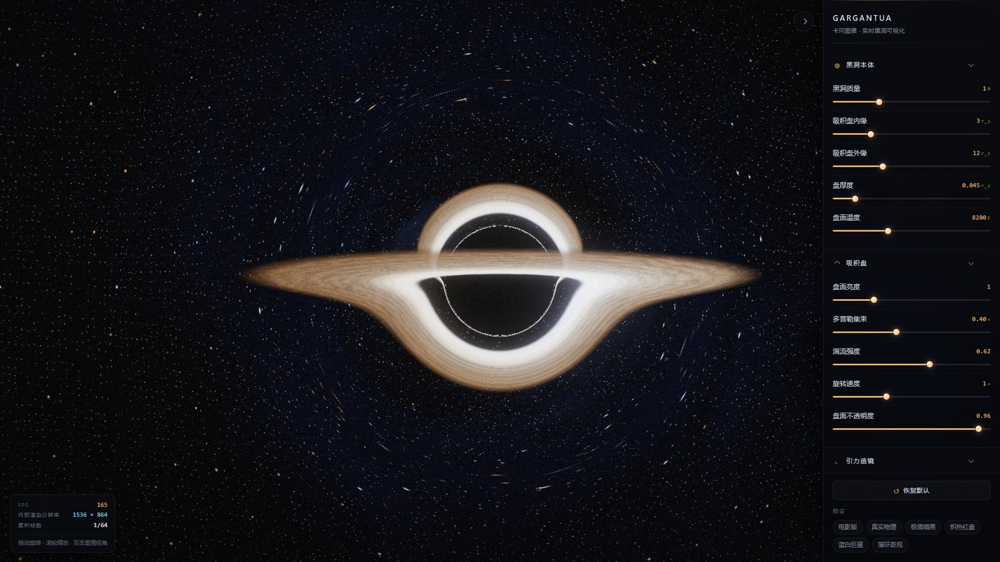
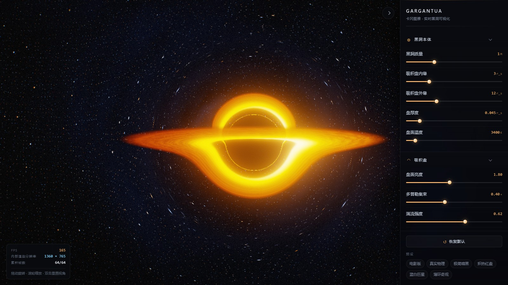
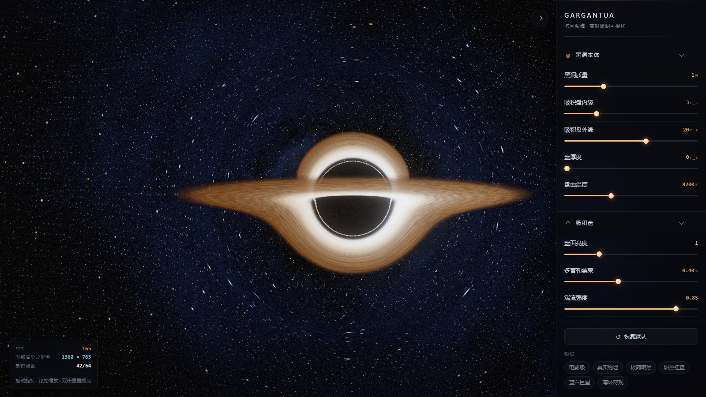

# GARGANTUA · 卡冈图雅

基于 WebGL2 的**实时黑洞渲染器**，目标是还原电影《星际穿越》里那颗黑洞——卡冈图雅（Gargantua）的视觉特征：炽热的吸积盘、被引力弯折出的上下光环、以及阴影边缘那道极细的光子环。

直接用浏览器打开 `index.html` 即可运行，**无需安装、无需构建、无需联网**（全部本地文件，零外部依赖）。



| 炽热红盘（3400 K） | 薄环奇观（零厚度盘 + 强透镜） |
|---|---|
|  |  |

---

## 快速开始

```
双击 index.html
```

或者起一个本地服务器（可选，两者行为一致）：

```bash
npx serve .          # 或 python -m http.server
```

**浏览器要求**：支持 WebGL2 的现代浏览器（Chrome / Edge / Firefox / Safari 15+）。
需要开启硬件加速。不支持 WebGL2 时页面会显示明确的错误提示而不是白屏。

---

## 操作方式

| 操作 | 效果 |
|---|---|
| **拖动鼠标** | 环绕黑洞旋转视角（带惯性） |
| **滚轮 / 双指捏合** | 推拉镜头 |
| **双击画面** | 平滑复位到默认视角 |
| **侧边栏** | 调整全部渲染参数，实时生效 |
| **右上角箭头** | 折叠 / 展开侧边栏 |
| **预设按钮** | 一键切换六种风格 |

镜头闲置 2.2 秒后会自动缓慢环绕（可在侧边栏关闭）。

---

## 物理模型

这不是一张贴图，也不是屏幕空间的特效近似。每个像素都在做**光线追踪**，追踪的是史瓦西度规下的零测地线。

### 光线弯曲

在笛卡尔坐标下，光子轨道满足（Binet 公式的矢量形式）：

```
d²x/dλ² = −3 · M · h² · x / r⁵        h = |x × dx/dλ| = const
```

因为加速度始终沿径向，角动量 `h` 精确守恒——所以这是**精确解，不是近似**，且 `h²` 只需在初始条件处算一次。

积分用**速度 Verlet**（辛积分器，能量漂移小），步长自适应且同时约束径向位移与角向转角（见下文「性能」一节）。

关键尺度（`M = r_s / 2`）：

- **视界** `r = r_s = 2M`
- **光子球** `r = 3M = 1.5 r_s` —— 光子环的来源
- **ISCO**（最内稳定圆轨道）`r = 6M = 3 r_s` —— 吸积盘内缘的物理默认值

### 引力透镜

光线绕过黑洞时被弯曲，于是**吸积盘背面发出的光被折到黑洞上方和下方**，形成那两道标志性的拱形光环。这是光线追踪自然给出的结果，不是额外画的图层——把「引力透镜强度」拉到 0，光环会立刻消失、退化成一张平面圆盘，可以直接看出差别。

同样自然地产生：

- **爱因斯坦环** —— 黑洞正后方星空的环形畸变
- **次级像 / 高阶像** —— 光线绕行一圈以上再逃逸形成的极细的次级结构
- **阴影** —— 比视界本身大约 2.6 倍的黑色区域，因为连掠射光线也逃不出来

### 光子环

在光子球 `r = 1.5 r_s` 附近绕行的光线会堆积在阴影边缘，形成一圈极细的亮环。有限积分步数下高阶像会偏暗，所以额外叠加了一层解析光晕（基于每条光线记录的**最近接近距离** `minR`），让这道环立住。这是判断「是否真的在算相对论」最直观的细节。

### 吸积盘

- **温度分布**：Shakura–Sunyaev 薄盘 `T ∝ r^(−3/4)`，内圈炽白（约 1.0× 设定温度）到外圈掉到约 0.22×，自然呈现白热 → 金 → 琥珀的过渡。颜色走**黑体辐射**查表（Planck 轨迹近似），不是随手调的颜色渐变。
- **亮度**：近似 Stefan–Boltzmann 的陡降 `∝ (T/T_in)^(1.45)`。
- **相对论效应**：多普勒集束 `1/(γ(1−βcosθ))` 配合引力红移 `√(1−r_s/r)`。朝向观察者的一侧被显著提亮，背离的一侧变暗——物理上是对的，电影为了画面平衡弱化了它，所以这里做成了可调参数（默认 0.4，介于物理与电影之间）。
- **湍流**：在共转参考系里采样 3 层 fbm 值噪声，径向频率远高于角向，才能拉出沿轨道流动的细丝而不是各向同性的斑块。角速度按开普勒 `Ω ∝ r^(−3/2)`，所以内圈转得快、外圈转得慢，条纹会被自然剪切。
- **盘面厚度**：`0` 时是精确的平面求交（电影里那种纸片薄盘）；调大后改用体积吸收积分。

### 星空

程序化生成，三层不同密度 + 温度分布（`2800K – 17000K` 黑体色）+ 极淡的银河尘埃带。星点用解析高斯核而不是采样贴图，所以**无论怎么放大都锐利**，并且能被引力透镜拉成细长的弧——这是最容易看出透镜效应的细节。

---

## 渲染管线

```
光线追踪 → HDR 场景缓冲 (RGBA16F)
   ↓
时间累积（乒乓缓冲，渐进式抗锯齿，最多 64 帧）
   ↓
泛光：亮度提取 → 6 级下采样 → 6 级加性上采样
   ↓
合成：色差 + 曝光 + 饱和度 + ACES 色调映射 + 暗角 + 胶片颗粒
   ↓
屏幕
```

几个刻意的设计决定：

- **不用 MSAA**。全屏光线追踪是纯片元着色器，没有几何边缘，MSAA 对它毫无帮助。抗锯齿只能靠**亚像素抖动（Halton 2,3 序列）+ 时间累积**。
- **累积缓冲用乒乓双缓冲**。任何一次 draw 的采样源都不能是它正在写入的纹理（反馈环 → 未定义行为）。泛光上采样同理，改用加性混合而不是读回自身。
- **累积有权重下限**（`blend ≥ 0.10`）。盘面一直在转，如果无限平均下去会拖出残影；所以新样本权重不会无限减小，静止时依然能收敛到很干净的画面。
- **泛光走加性混合**，6 级金字塔覆盖从紧贴亮边到大范围柔光的全部尺度。
- **HDR 缓冲**（`RGBA16F` + `EXT_color_buffer_float`），泛光阈值以上才提取，所以只有真正亮的部分会发光。不支持浮点缓冲时自动退化为 LDR 并给出警告，不会崩。

---

## 性能

在 **RTX 4060 Ti** 上，1600×900 视口、默认「高」画质（288 积分步）实测稳定 **165 FPS**（内部渲染分辨率 1280×720，已收敛到 64/64 采样）。

自适应的三层保护：

1. **分辨率缩放** —— 内部渲染分辨率独立于画布尺寸，默认 0.85×。
2. **自动降级** —— 帧率持续低于 32 FPS 时自动降低渲染比例，回升后自动调高。
3. **像素上限** —— 内部缓冲不超过 260 万像素，4K 屏不会把显卡打爆。

画质档位（侧边栏可切）：

| 档位 | 积分步数 | 说明 |
|---|---|---|
| 低 | 160 | 集成显卡可用，透镜光环仍然完整 |
| 中 | 240 | |
| 高 | 340 | 默认，精度与性能平衡点 |
| 极高 | 512 | 高阶像、爱因斯坦环更完整 |

步数是**编译期常量**（通过 `#define` 注入），所以着色器里的循环能被完全展开，比运行时 uniform 循环快得多。

步长不是简单地按半径取，而是同时约束**径向位移**和**角向转角** `dφ ≈ h/r² · dt`。只按半径取步长会浪费预算：近径向的光线（`h≈0`）根本不需要细步，而掠过光子球的光线需要极细的步。用转角约束能在同样的步数下拿到高得多的精度——这是「低」档位也能保住透镜拱形光环的原因。

---

## 侧边栏参数

共 24 个参数，分五组：

- **黑洞本体** —— 质量、盘内/外缘、盘厚度、盘面温度
- **吸积盘** —— 亮度、多普勒集束、湍流强度、旋转速度、不透明度
- **引力透镜** —— 透镜强度、光子环强度、星空亮度、透镜色散
- **镜头与后期** —— 曝光、泛光强度/半径、镜头色散、暗角、胶片颗粒、时间累积、自动旋转
- **画质** —— 渲染质量、分辨率缩放

**六个预设**：

| 预设 | 特征 |
|---|---|
| 电影版 | 《星际穿越》的观感：白热内环 + 琥珀外盘 + 弱化多普勒 |
| 真实物理 | 完整多普勒集束、更薄的盘、几乎无色差 |
| 极简暗黑 | 压暗的星空、克制的辉光、强暗角 |
| 炽热红盘 | 3400K 的橙红盘，像一颗正在吞噬的恒星 |
| 蓝白巨星 | 2.4 倍质量、17000K 的蓝白盘 |
| 薄环奇观 | 零厚度盘 + 强透镜，光环最戏剧化 |

---

## 文件结构

```
index.html            页面骨架
css/style.css         电影感深色 UI（玻璃拟态侧边栏 / 自定义滑块 / 开关）
js/params.js          ★ 参数契约 —— UI 与渲染层唯一的接口
js/shaders.js         全部 GLSL ES 3.00 着色器
js/camera.js          轨道相机（拖动 / 滚轮 / 惯性 / 自动适配宽高比）
js/renderer.js        WebGL2 管线（HDR 目标 / 时间累积 / 泛光 / 合成）
js/ui.js              侧边栏与 HUD（完全由 params.js 的定义表生成）
js/app.js             引导 + 主循环 + 性能自适应
tools/                验证工具（不参与运行时）
```

`js/params.js` 是单一事实来源：加一个参数只需要在 `DEFS` 里加一条，侧边栏控件会自动出现，无需改 UI 代码。

---

## 验证工具

```bash
node tools/preflight.mjs      # 静态检查（文件/语法/脚本顺序/无外部依赖/DOM id）
node tools/glsl-check.mjs     # 在真实 Chrome 里编译全部着色器
node tools/interact-test.mjs  # 真实鼠标事件：拖动/滚轮/双击/预设/滑块/侧边栏
node tools/shot.mjs --out .tmp/shot.png   # 截图 + 控制台错误捕获
node tools/qa.mjs             # 完整验收（汇总以上全部）
```

当前状态：preflight 13/13 通过，8 个着色器全部编译通过，交互测试 9/9 通过，控制台零错误。

---

## 已知限制

- **史瓦西解，不是克尔解**。真实黑洞几乎都在自旋，自旋会让阴影变成不对称的 D 形并产生参考系拖曳。这里用的是球对称解——电影里的卡冈图雅也是史瓦西（因为克尔解的渲染复杂度高得多）。
- **吸积盘不是磁流体力学模拟**。湍流是程序化噪声在共转系里的采样，视觉上可信但不是求解出来的物理。
- **没有考虑盘的自遮挡**（光学薄近似）。真实薄盘在掠射角下会遮挡自己。
- **没有引力红移造成的谱线移动**（只有整体亮度/色温偏移）。
